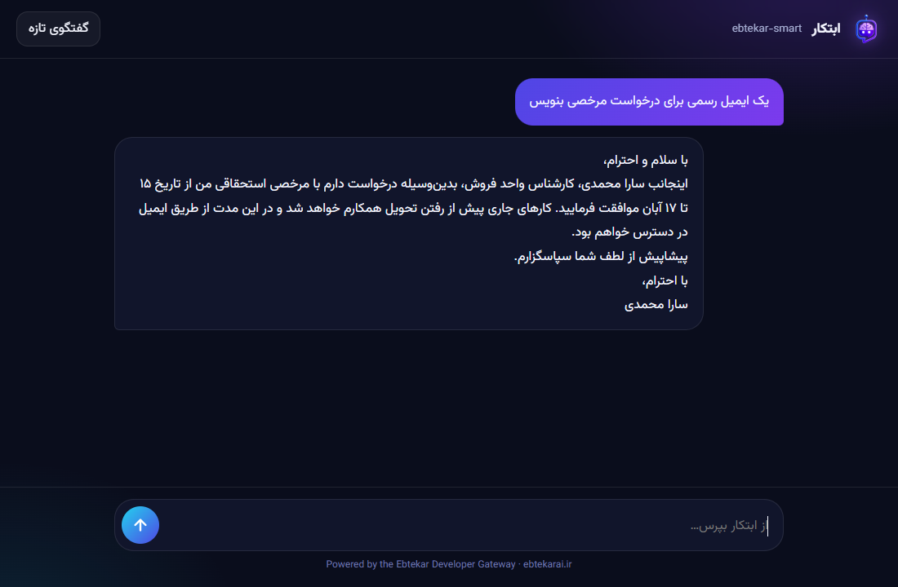
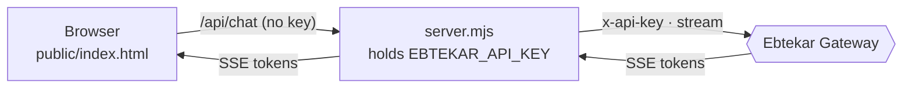

<div align="center">


# Ebtekar Chat UI

**A minimal, RTL-first web chat for the Ebtekar Developer Gateway, with zero dependencies.**

یک رابط چت وب سبک و راست‌به‌چپ برای درگاه توسعه‌دهندگان ابتکار، بدون هیچ وابستگی


</div>



---

## Why / چرا

Calling the API straight from a web page would leak your key. This project puts a **tiny Node server** in between: it serves the page, holds the key, checks every request and streams the model's answer back live.

صدا زدن API مستقیم از صفحهٔ وب کلید شما را لو می‌دهد. این پروژه یک **سرور کوچک Node** وسط می‌گذارد که صفحه را نمایش می‌دهد، کلید را نزد خودش نگه می‌دارد، هر درخواست را بررسی می‌کند و پاسخ مدل را به‌صورت زنده برمی‌گرداند.



## Features / قابلیت‌ها

- ⚡ Live streaming answers (Server-Sent Events)
- 🔐 The key never leaves the server
- 🛡️ Input checks: message count, length and roles
- 🚦 Per-IP rate limit (default 20 requests/minute)
- 🛑 Stop when the visitor leaves: the model request is cancelled and stops costing
- 🔁 A unique `Idempotency-Key` on every request
- 🇮🇷 RTL Persian interface with the Vazirmatn font, which also works for English
- 📦 Zero npm dependencies

## Quick start / شروع سریع

```bash
git clone https://github.com/EbtekarAi/chat-ui.git
cd chat-ui
cp .env.example .env        # then put your key in .env
npm start                   # → http://localhost:3000
```

Get a key at **[ebtekarai.ir/developers](https://ebtekarai.ir/developers)**.
کلید را از **[ebtekarai.ir/developers](https://ebtekarai.ir/developers)** بسازید.

## Configuration / تنظیمات

| Variable | Default | Description |
|---|---|---|
| `EBTEKAR_API_KEY` | — | **Required.** Your `ebt_live_…` key |
| `EBTEKAR_MODEL` | `ebtekar-smart` | Any model ID from `GET /v1/models` |
| `EBTEKAR_MAX_TOKENS` | `2048` | Output cap per answer |
| `EBTEKAR_SYSTEM` | Persian assistant prompt | System instructions |
| `PORT` | `3000` | HTTP port |
| `RATE_PER_MIN` | `20` | Requests per minute per visitor IP |

## Deploy / استقرار

Any host that runs Node 20.12+ works: a VPS, Docker or a PaaS. Set the variables in your host's panel instead of shipping a `.env` file, and put the app behind HTTPS.

هر میزبانی که Node 20.12 به بالا اجرا کند مناسب است. متغیرها را در پنل میزبان تعریف کنید، فایل `.env` را آپلود نکنید و برنامه را پشت HTTPS قرار دهید.

## Related / مرتبط

- 📘 [Developer guide](https://github.com/EbtekarAi/ebtekar-ai/blob/main/docs/developers.md) · [راهنمای فارسی](https://github.com/EbtekarAi/ebtekar-ai/blob/main/docs/developers.fa.md)
- 🍳 [Cookbook](https://github.com/EbtekarAi/ebtekar-cookbook) · 🧾 [OpenAPI spec](https://github.com/EbtekarAi/openapi)

<sub>MIT © Ebtekar AI</sub>
